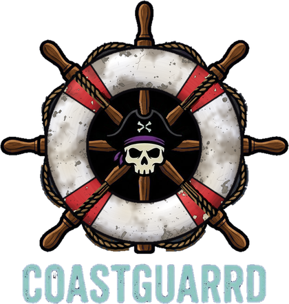

<p align="center">
  
</p>

<h1 align="center">CoastGuarrd</h1>

<p align="center">
  Watch tracking and safe library cleanup for <b>Jellyfin</b>, <b>Seerr</b>, <b>Radarr</b>, <b>Sonarr</b> and <b>Lidarr</b> — in one app.
</p>

---

CoastGuarrd keeps an eye on who watches what on your Jellyfin server, and helps you clear out the titles nobody watches — **without ever deleting anything on its own**.

- **Track everything** — live streams, full watch history, devices and apps, sign-in times, locations on a map, and alerts for shared accounts or far-apart sign-ins.
- **Know who asked for what** — every Seerr request, and whether the person who asked ever watched it.
- **Flag unwatched titles** — rules decide what counts as unwatched. Flagged titles get a "Leaving in X days" banner on their poster and appear in a "Leaving Soon" collection.
- **A recycle bin, not a shredder** — when the countdown ends, files are *moved* to a recycle bin on the same drive. Restore with one click, or empty it yourself. CoastGuarrd never empties it for you.
- **Preview mode** — on by default. See what would happen before anything changes.
- **Secure by default** — encrypted database, two-factor sign-in, lockout after repeated failures, and correct visitor addresses behind Cloudflare tunnels.
- **Phone friendly** — the whole interface works on desktop and mobile.

> **Status:** all five phases are built — sign-in & setup, watch tracking, cleanup rules with poster banners, the recycle bin, and notifications. Early days: please report anything odd.

## What it tracks

- **Live activity** — every stream with progress, quality, direct play vs transcode (and why), device, app, address and location. Send a message to a stream or stop it.
- **History** — every play: when it started and stopped, how long was actually watched, pauses, device and place. Older history can be imported from Jellyfin (full history if the *Playback Reporting* plugin is installed).
- **Users** — a profile for each person: sign-in dates and times, every device and address they've used, a map of where they watch, when they watch (day × hour), favourite titles, apps, requests and alerts. Add private notes and a per-person stream limit.
- **Map** — where people watch and sign in from, plus who's watching right now.
- **Requests** — every Seerr request, who asked, and whether they ever watched it.
- **Alerts** — impossible travel, streaming from two places at once, too many streams, lots of different addresses, new devices, new countries and repeated failed Jellyfin sign-ins. Each person gets a trust score.

## Install on Unraid

1. Copy `unraid/coastguarrd.xml` to `/boot/config/plugins/dockerMan/templates-user/` on your Unraid flash drive (or add it through Community Applications once listed).
2. In **Docker → Add Container**, pick **CoastGuarrd** from the template list.
3. Set:
   - **Web UI port** — any free port.
   - **Media** — the folder that holds *all* your media. Use `/mnt/user/` for array shares or `/mnt/disks/` for Unassigned Devices drives. Keep the access mode as **RW/Slave**.
4. Start the container and open the web UI. You'll create your admin account, then a setup wizard walks you through the rest.

## Install with Docker

```yaml
services:
  coastguarrd:
    image: ghcr.io/thepixlpirate/coastguarrd:latest
    container_name: coastguarrd
    restart: unless-stopped
    ports:
      - "8787:8787"
    environment:
      - TZ=America/New_York
      - PUID=1000
      - PGID=1000
    volumes:
      - ./config:/config
      - /path/to/your/media:/media:rslave
```

## How folders and recycle bins work

Each app sees your media at its own path (Radarr might call it `/movies`). The setup wizard asks each app for its folders and helps you match them to where CoastGuarrd sees them under `/media`.

For every folder, CoastGuarrd picks a recycle bin (`.coastguarrd-recycle`) at the top of **the same drive**. Moves within one drive are instant; moves between drives would copy whole files, so CoastGuarrd warns you if a recycle bin is on a different drive.

Before moving a title, CoastGuarrd tells Radarr/Sonarr/Lidarr to stop monitoring it so it isn't downloaded again. Restoring turns monitoring back on.

## Settings reference

| Variable | Default | What it does |
| --- | --- | --- |
| `CG_PORT` | `8787` | Port the web interface listens on inside the container. |
| `CG_DATA_DIR` | `/config` | Where the encrypted database and key file live. |
| `CG_MEDIA_ROOT` | `/media` | Where your media is mounted inside the container. |
| `CG_DB_KEY` | *(random)* | Database encryption key. If unset, one is generated and saved to `/config/.dbkey`. |
| `PUID` / `PGID` | `99` / `100` | User and group files are created as. |
| `TZ` | — | Your time zone. |

**About the encryption key:** if you let CoastGuarrd generate the key, it's stored next to the database in `/config`. That protects copies of the database file on their own (backups, for example), but anyone with your whole appdata folder has both. For stronger protection set `CG_DB_KEY` yourself and keep it somewhere safe — the database can't be opened without it.

## Cleanup

- **Rules** — build rules from conditions like *days since anyone watched*, *never watched*, *days since added*, *requested but the requester never watched*, *size*, *rating*, *genre*, *tag*, *how full the drive is*, *show has ended* and more. Every rule has a live preview showing exactly what it would flag.
- **Protections** — titles tagged `keep` (in Radarr/Sonarr/Lidarr or Jellyfin), anyone's favourites, recent requests, recent additions and whole libraries (e.g. Kids) are never flagged. You can also keep any title for 30 days, 90 days or forever.
- **Leaving Soon** — flagged titles get a *"Marked for removal in X days"* banner on their poster (the original is saved and put back if they're kept or watched) and appear in a Jellyfin collection. Watching a title removes the flag automatically.
- **Recycle bin** — when a countdown ends, Radarr/Sonarr/Lidarr stop monitoring the title and its folder is **moved** to `.coastguarrd-recycle` on the same drive. Restore puts it back and turns monitoring on again. **Nothing is ever deleted unless you press "Delete forever" or "Empty recycle bin".** Deleting can also remove the title from Radarr/Sonarr and clear it in Seerr so it can be requested again.
- **Leftover downloads** — old items in your downloads folder are listed and can be moved to the bin.
- **Preview mode** — on by default: rules flag titles so you can review them, but no posters change and nothing moves.

## Notifications

Discord, email and generic webhooks for alerts, flagged titles, moves, family keep requests and a weekly summary. An optional **family page** (secret link, no sign-in) lists what's leaving with a **Keep it** button, and can be emailed to everyone in Seerr each Sunday.

## Locations

Addresses are turned into approximate (city-level) locations **on your server** using the free [DB-IP](https://db-ip.com) "IP to City Lite" database (CC BY 4.0), downloaded automatically each month. No addresses are ever sent to an outside service. To use MaxMind instead, put `GeoLite2-City.mmdb` in `/config/geoip/` and restart.

The map's background tiles come from CARTO / OpenStreetMap.

**If everyone shows up as "Local network":** Jellyfin is probably seeing your tunnel or reverse proxy instead of the real visitor. In Jellyfin go to **Dashboard → Networking** and add the tunnel/proxy's address under **Known proxies**.

## Behind a Cloudflare tunnel or reverse proxy

Leave **Settings → Security → Read real visitor addresses** switched on. CoastGuarrd then uses Cloudflare's `CF-Connecting-IP` (or `X-Forwarded-For`) header — but only when the request comes from your own network, so the header can't be faked from outside.

## Development

```bash
# Server (port 8787)
cd server && npm install && CG_DATA_DIR=./.data CG_MEDIA_ROOT=/path/to/media npm run dev

# Web interface (port 5173, talks to the server)
cd web && npm install && npm run dev
```

Every push to `main` builds a fresh image at `ghcr.io/<owner>/coastguarrd:latest` through GitHub Actions.

## Credits

CoastGuarrd is inspired by [Tracearr](https://github.com/connorgallopo/Tracearr), [Maintainerr](https://github.com/jorenn92/Maintainerr) and [Janitorr](https://github.com/Schaka/janitorr). It is an independent project and shares no code with them.

## License

MIT
